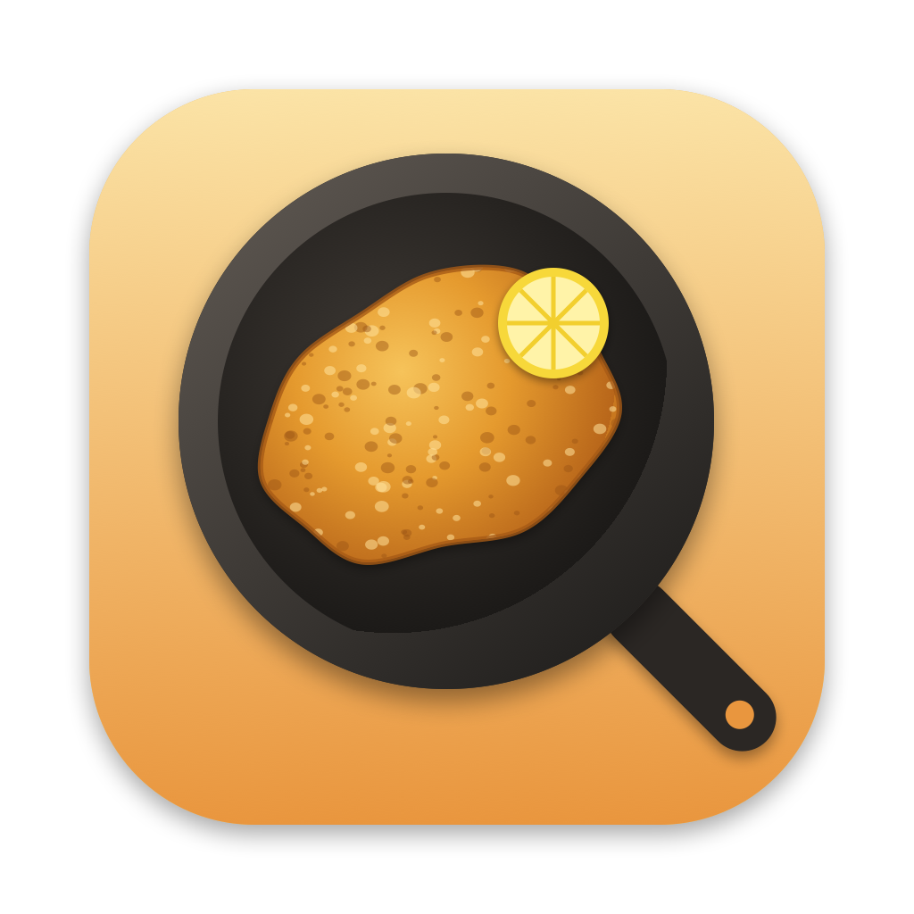

<p align="center">
  
</p>

# Schnitzel

*Windows games, pounded flat for your Mac.*

Schnitzel is a free, open-source Mac app for running Windows games with Wine. Each game setup lives in a **Pfanne** (plural **Pfannen**): a self-contained Windows environment with its own settings, Wine engine version and graphics layer.

> [!NOTE]
> Schnitzel is in early development. It can download Wine engines, DXVK and DXMT, import your own D3DMetal, create Pfannen and run Windows programs in them, through a basic interface. The real interface comes next. See [SCHNITZEL_PLAN.md](SCHNITZEL_PLAN.md) for the roadmap.

## Requirements

- An Apple Silicon Mac with macOS 14 Sonoma or later.
- Rosetta 2, which Wine needs to run Windows programs:
  ```
  /usr/sbin/softwareupdate --install-rosetta --agree-to-license
  ```

## Building

You need the Xcode Command Line Tools (`xcode-select --install`). Full Xcode is not required.

```
scripts/build-app.sh
open build/Schnitzel.app
```

Run the tests with:

```
scripts/test.sh
```

To also check that every download source still lists versions on GitHub (needs internet):

```
SCHNITZEL_NETWORK_TESTS=1 scripts/test.sh
```

The app icon is an original illustration drawn in code. After changing [scripts/make-icon.swift](scripts/make-icon.swift), run `swift scripts/make-icon.swift` to regenerate `Resources/AppIcon.icns`.

## D3DMetal

Schnitzel does **not** include Apple's D3DMetal. Its license doesn't allow redistribution. Schnitzel will detect a D3DMetal you installed yourself from Apple's Game Porting Toolkit (free Apple ID required).

## Credits

Schnitzel builds on the work of these projects and people:

- [Sikarugir](https://github.com/Sikarugir-App/Sikarugir), the successor to Kegworks and Wineskin. This repository started as a fork of its public repository.
- [Kegworks](https://github.com/Sikarugir-App/Sikarugir) and [Wineskin](https://github.com/vitor251093/wineskin): doh123 created Wineskin, and [VitorMM](https://github.com/vitor251093) modernized it and wrote Sikarugir-App. [PaulTheTall](https://www.paulthetall.com/) provided constant test data and bug finding.
- [Whisky](https://github.com/Whisky-App/Whisky) by Isaac Marovitz and contributors. Parts of WhiskyKit are reused in Schnitzel under the GPL-3.0; those files keep their original copyright headers and note Schnitzel's changes.
- [Wine](https://www.winehq.org), which does the actual work of running Windows programs.
- [Gcenx](https://github.com/Gcenx), who maintains the Wine builds for macOS, DXVK-macOS and much more.

Schnitzel is not affiliated with or endorsed by any of these projects.

## License

Schnitzel is free software under the [GNU General Public License v3.0](LICENSE), or (at your option) any later version.

Third-party components keep their own licenses. Wine is LGPL-2.1, and DXVK, MoltenVK and DXMT use their own open-source licenses. D3DMetal is Apple's and is never distributed with Schnitzel.
